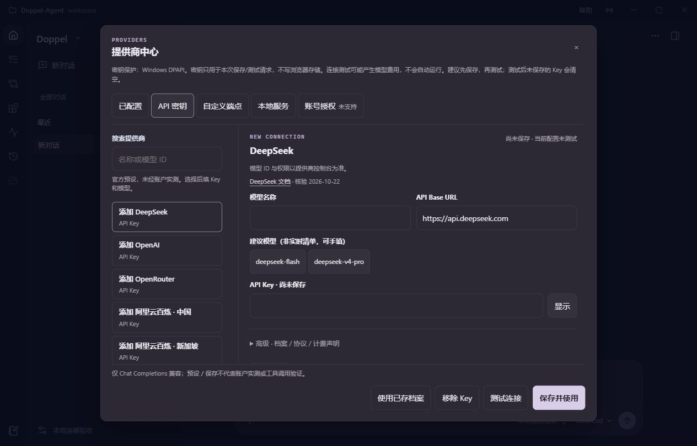

# 提供商中心：界面简化与连接验收

日期：2026-10-23（Asia/Shanghai）。这是当前源码与独立候选构建的增量交付，
**不是新版本发布，也未替换既有 v0.15.0-rc.1 下载包或日常 EXE**。

## 从长表单变成连接工作流

- 拆成「已配置 / API 密钥 / 自定义端点 / 本地服务 / 账号授权」。
- 收录 **24 条连接预设：20 条云端、4 条本地服务**；支持搜索、中文别名、
  官方文档链接、文档核验日期和可编辑模型提示，不声称覆盖所有网上提供商。
- 常用操作只展示模型、Base URL、Key；档案名称、协议预设、旧价格与固定
  计费声明收进默认折叠的高级区，未删除原有计费安全约束。
- 选择目录条目创建新草稿，不覆盖已存档案。MiMo 按量与 Token Plan、
  阿里云区域、Ollama 本地与云端明确区分，不自动切换套餐或兜底。
- 「保存并使用」先保存，再通过当前引擎的 API 绑定当前对话。
  「使用已存档案」不保存未提交的编辑；归档/忙碌时只允许保存默认档案。
  保存成功但应用失败或未确认时分别提示，不伪称已应用，不自动重试。
- 测试连接是单独操作，可能收费；保存/应用不会自动发送模型请求。
  密钥继续由原有 DPAPI 路径保护，不回显保存的 Key，不写浏览器存储。
  保留 App 级设置请求所有权、未知结果门禁和迟到回复显式采用机制。

## 已执行的验证

| 验证 | 实际结果 / 边界 |
|---|---|
| 前端全量 Vitest | **59 个文件、565 项通过**；包括真实组件+控制器的离线契约测试 |
| Vue TypeScript + Vite 7.3.6 | 构建成功；仍有单 JS chunk 超过 500 kB 的体积提示 |
| 设置/计费/密钥/探测后端回归 | **85 项通过**，不是后端全量测试 |
| 浏览器交互 | 实际 DesktopKernel + 当前生产 bundle + 隔离工作区；搜索“小米”、创建并保存、显式本地探测、修改后状态失效、使用已存档案均实测 |
| 当前对话绑定 | 在浏览器操作后，通过原生会话 GET API 验证持久化 profile_id 与所选已存档案一致；不只检查全局默认或 UI 文本 |
| 外部模型/账单 | **0 次外部请求**；仅 1 次显式本机 Chat Completions fixture 请求，不读取/解密真实 Key，不查询余额，不提交 Agent 运行 |
| 布局观察 | 浏览器 viewport 1264×811、900×620、375×812；目录与编辑区可滚动，底部操作保留可达 |
| 独立候选打包 | wheel、sdist、onedir EXE 成功；manifest 记录 daily_app_unchanged=true、app_launched=false、native_acceptance=false |
| 审查 | 指定 GPT-6.1 Sol / high 子 Agent 完成主体实现；独立 reviewer 因额度限制未产出，不能称独立审查通过；主 Agent 人工复核并补充 Legacy 服务端未确认切换的回归 |

后端回归命令（仓库根目录，PowerShell）：

```powershell
./.venv/Scripts/python.exe -m pytest -q tests/test_settings_price_boundaries.py tests/test_billing_tariff_settings.py tests/test_settings_persistence_lifetime.py tests/test_settings_file_source_retention.py tests/test_provider_probe_cleanup.py
```

## 可见证据



这张图是 **in-app browser 中实际本地应用页面的未修改截图**，viewport
1264×811，使用隔离示例工作区；不是原生 Windows 窗口截图、设计稿或付费
Provider 连接成功证明。空模型与 Key 是刚选择 DeepSeek 后的新连接草稿。

本机候选目录：
`D:/Codex Program files/Agent/Doppel-Agent/.artifacts/provider-center-candidate-20261023/`。
EXE 位于其中 `desktop/DoppelAgent/DoppelAgent.exe`，必须保留同级依赖目录；
不要只复制单个 EXE。仍使用工程版本 0.15.0rc1，而非创建新发布版本。
构建过程没有启动该 EXE；原生窗口、退出排空及完整运行时矩阵仍待验收。

## 没有冒充已实现的功能

本版只有 OpenAI-compatible **Chat Completions** 适配与离线 Mock。
OAuth/订阅账号登录、Anthropic Messages、原生 Responses、自动 `/models`
发现、本地推理引擎/模型下载与硬件推荐均未实现；账号页明确显示未支持。
文档核验不是账号实测，工具调用和具体模型权限仍需独立验证。

后续按[分阶段方案与官方来源](../plans/2026-10-22-provider-center.md)推进：
先显式模型发现与协议适配，再评估官方授权流程，最后做受管理本地推理；
不通过抓 Cookie、复用其他应用 Token 或伪造登录按钮实现“一键连接”。
